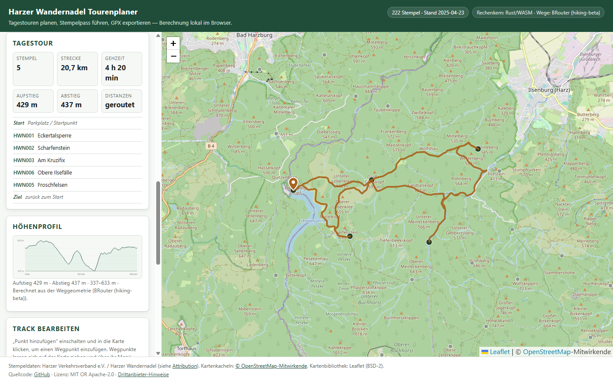

# Harzer Wandernadel Tourenplaner

Ein Tourenplaner für die **Harzer Wandernadel**: Stempelstellen auswählen,
Wanderparkplätze in der Nähe finden, eine Tagestour **entlang echter Wanderwege**
berechnen, den Track mit eigenen Wegpunkten anpassen und als GPX mit
Höhenprofil exportieren. Ein Stempelpass hält fest, welche der 222 Stempel
schon gesammelt sind. Die Berechnung läuft im Browser als
Rust/WebAssembly-Modul; es gibt keinen Server, kein Konto und keine Telemetrie.

[](https://github.com/rabvz/harz-stamp-route-planner/actions/workflows/ci.yml)
[](#lizenz)

> **Projektstatus: Alpha.** Der Planer rechnet entlang echter Wege, findet
> Wanderparkplätze über OpenStreetMap und exportiert GPX samt Track. Was noch
> fehlt, steht ungeschönt unter [Grenzen](#grenzen-und-offene-punkte).



## Funktionen

| Funktion | Status | Anmerkung |
| --- | --- | --- |
| 222 Stempelstellen mit Koordinaten | **fertig** | aus der amtlichen GPX-Datei, Stand 23.04.2025 |
| Interaktive Karte mit Auswahl | **fertig** | Klick auf Marker oder Liste |
| Suche und Filter | **fertig** | nach Name, Ort und HWN-Nummer |
| **Stempelpass** | **fertig** | Stempel als „bereits gestempelt“ markieren, Fortschritt x/222, Filter auf ungestempelte |
| **Routing entlang von Wanderwegen** | **fertig** | BRouter, Profil `hiking-beta`, ohne Schlüssel |
| **Wanderparkplätze aus OpenStreetMap** | **fertig** | Overpass-Abfrage im Umkreis, nach erreichbaren Stempeln sortiert |
| Automatische Gruppierung | **fertig** | deterministisch, mit Durchmesser- und Stempel-Limit |
| Tourenoptimierung | **fertig** | Nearest-Neighbour + 2-opt, danach echte Wege |
| **Tagestour** | **fertig** | eine Tour pro Planung, mit Streckenlimit und Warnung statt stillem Kürzen |
| **Track bearbeiten** | **fertig** | Wegpunkte setzen, ziehen (Einrasten auf der Weggeometrie) und entfernen; Route wird neu berechnet |
| **Höhenprofil** | **fertig** | aus der Höhe der BRouter-Geometrie, mit Auf- und Abstieg |
| GPX-Export (Wegpunkte und Track) | **fertig** | GPX 1.1, inklusive Weggeometrie und Höhe je Trackpunkt |
| GPX-Import | **fertig** | ordnet `HWNnnn`-Namen Stempelstellen zu |
| Offline-Bedienung (PWA) | **eingeschränkt** | Oberfläche und Rechenkern ja; Karte und Routing nein |
| Persönliche Daten lokal | **fertig** | IndexedDB, Import und Export als JSON; Auswahl, Stempelpass und Einstellungen |

## Live-Demo

<https://rabvz.github.io/harz-stamp-route-planner/>

Der Deployment-Workflow (`.github/workflows/deploy-pages.yml`) baut die Seite bei
jedem Push auf `main`; GitHub Pages ist aktiviert. `main` ist durch eine
Branch-Protection geschützt: Änderungen laufen über Pull Requests, Force-Pushes
und Löschen des Branches sind gesperrt.

## Schnellstart für Entwickler

Voraussetzungen: ein Rust-Toolchain (siehe `rust-toolchain.toml`) und – für den
optionalen Browser-Smoke-Test – Node.js 22.

```bash
cargo xtask ci        # alle Prüfungen: fmt, clippy, Tests, Daten, WASM, Web
cargo xtask web       # baut dist/ (statische Seite inklusive WASM)
cargo xtask serve     # liefert dist/ auf http://127.0.0.1:8080
```

`cargo xtask help` listet alle Befehle. Weitere Hinweise, auch zur Installation
einer werkseigenen Toolchain ohne Systemänderung, stehen in
[docs/development.md](docs/development.md).

### Browser-Smoke-Test

`cargo test` prüft den Rust-Kern, nicht die Seite. Der folgende Test startet ein
Headless-Chromium und prüft Start, Auswahl, Stempelpass, Planung, Routing,
Höhenprofil, Track-Bearbeitung, Gruppierung, GPX-Export und die Persistenz:

```bash
cargo xtask web
cargo xtask serve      # in einem zweiten Terminal
node scripts/smoke-test.mjs http://127.0.0.1:8080
```

## Aufbau

Die Crates sind nach fachlicher Verantwortung getrennt; Abhängigkeiten zeigen
nur in eine Richtung:

```text
crates/
  geo-engine/        Koordinaten, Distanzen, Bounding-Boxes, Polylinien
  stamp-core/        Stempelmodell, Katalog, Auswahl
  parking-search/    Ranking von Parkplatzkandidaten
  stamp-clustering/  Gruppierung in Tagestouren
  routing-client/    Provider-Abstraktion, GeoJSON-Parser, Cache
  route-optimizer/   Reihenfolge, 2-opt, Tagestour
  gpx/               GPX lesen und schreiben
  wasm-bindings/     JSON-ABI für den Browser
xtask/               Entwickleraufgaben (ci, test, wasm, web, data, ...)
web/                 statische Oberfläche (HTML, CSS, JS, Leaflet)
```

Details und die erzwungenen Regeln: [ARCHITECTURE.md](ARCHITECTURE.md).

## Daten und Rechte

- **Stempelstellen**: amtliche GPX-Datei des Harzer Verkehrsverbands, Stand
  23.04.2025. Die Datei liegt unverändert unter `data/official/`, Herkunft und
  Prüfsumme in `data/official/PROVENANCE.json`.
- **Kartenkacheln**: OpenStreetMap, ODbL, zur Laufzeit geladen und nicht
  archiviert.
- **Leaflet**: BSD-2-Clause, lokal eingebunden.
- **Projektcode**: MIT OR Apache-2.0.

Die Projektlizenz gilt **nicht** für die Stempeldaten oder die Kartenkacheln.
Vollständige Angaben: [ATTRIBUTION.md](ATTRIBUTION.md).

## Datenschutz

Auswahl, Stempelpass, Startpunkt und Einstellungen liegen ausschließlich im
Browser (IndexedDB). Es gibt keine Konten, keine Analyse und keine Cookies. Nach
außen gehen nur drei Arten von Anfragen:

1. Kartenkacheln an den konfigurierten Kachel-Server (Standard: OpenStreetMap).
2. Anfragen an BRouter für die Wegführung — eine Anfrage pro Tagestour und
   eine weitere nach jeder Track-Bearbeitung.
3. Eine Overpass-Abfrage für Wanderparkplätze — ausschließlich nach einem Klick
   auf „Parkplätze suchen“, nie beim Laden der Seite.

Alle drei Dienste sind in `web/js/config.js` austauschbar; wer eigene Instanzen
betreibt, kann die Adressen dort ersetzen.

## Grenzen und offene Punkte

Diese Liste ist Teil der Dokumentation, nicht ein Zukunftsversprechen:

- **Routing über einen öffentlichen Dienst**: Die Wegführung kommt von
  BRouter (Profil `hiking-beta`, Datenbasis OpenStreetMap). Ist der Dienst nicht
  erreichbar, zeigt die Oberfläche die Luftlinien-Schätzung und sagt das; der
  GPX-Export enthält dann keinen Track. Ein eigener BRouter lässt sich in
  `web/js/config.js` eintragen.
- **Optimierung auf Schätzung, Wege danach**: Die Reihenfolge der Stempel wird
  auf der geschätzten Distanz berechnet, erst die fertige Tagestour wird
  geroutet. Echte Wege weichen davon ab; die Oberfläche zeigt dann die geroutete
  Strecke. Eine Optimierung auf der echten Wegematrix ist offen.
- **Nur Tagestouren**: Der Planer plant bewusst eine Tagestour. Passt die Auswahl
  nicht in das Streckenlimit, bleibt sie vollständig und wird als zu lang
  markiert; sie wird nicht heimlich auf mehrere Tage verteilt.
- **Einrasten nur auf der berechneten Route**: Ein gezogener Wegpunkt rastet auf
  der aktuellen Weggeometrie ein — die liegt auf OpenStreetMap-Wegen. Weitere
  Wege in der Nähe werden nicht abgefragt; dafür bräuchte es eine Overpass-Abfrage
  bei jedem Zug. Liegt der Punkt weiter als 120 m entfernt, bleibt er frei und
  BRouter sucht selbst den nächsten Weg.
- **Parkplätze aus OpenStreetMap**: „Parkplatz“ heißt dort „jemand hat eine
  Fläche eingetragen“, nicht „offizieller Wanderparkplatz der Harzer
  Wandernadel“. Zugangsbeschränkungen sind gefiltert, Öffnungszeiten und
  Gebühren werden nicht ausgewertet.
- **Offline-Karte und Offline-Routing**: Die Bedienoberfläche und der Rechenkern
  funktionieren offline, Kartenkacheln und Wegführung nicht. Ein Kachel-Archiv
  wäre mit der Nutzungsrichtlinie von OpenStreetMap nicht vereinbar.
- **Navigation**: Der Planer plant Touren, er navigiert nicht.
- **Datenaktualität**: Neue oder eingezogene Stempelstellen erscheinen erst nach
  einem neuen Datensatz (`cargo xtask data`).

## Beitragen

Fehlerberichte, Datenkorrekturen und Pull Requests sind willkommen. Bitte zuerst
[CONTRIBUTING.md](CONTRIBUTING.md) und den
[Verhaltenskodex](CODE_OF_CONDUCT.md) lesen. Änderungen laufen über Feature-
Branches und Pull Requests; `cargo xtask ci` muss grün sein.

Für KI-Agenten gilt zusätzlich [AGENTS.md](AGENTS.md).

## Roadmap

Nächste Schritte stehen in [docs/roadmap.md](docs/roadmap.md), der aktuelle
Umsetzungsstand in [docs/development-status.md](docs/development-status.md).

## Lizenz

Lizenziert unter **MIT OR Apache-2.0**. Sie dürfen wählen.

- [LICENSE-MIT](LICENSE-MIT)
- [LICENSE-APACHE](LICENSE-APACHE)

Sofern nicht ausdrücklich anders angegeben, gilt die Lizenz nur für den
Quellcode dieses Projekts, nicht für die eingebundenen Daten und Karten.
